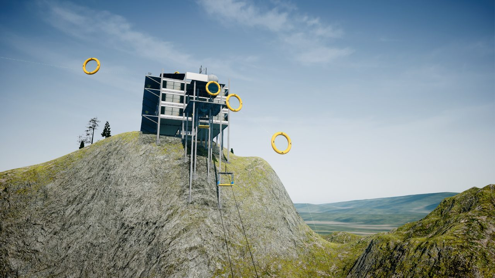
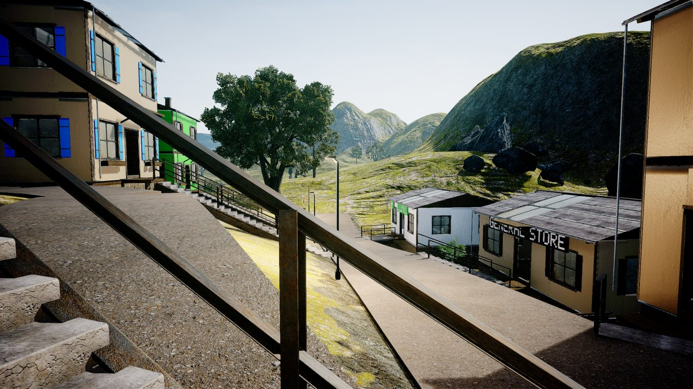
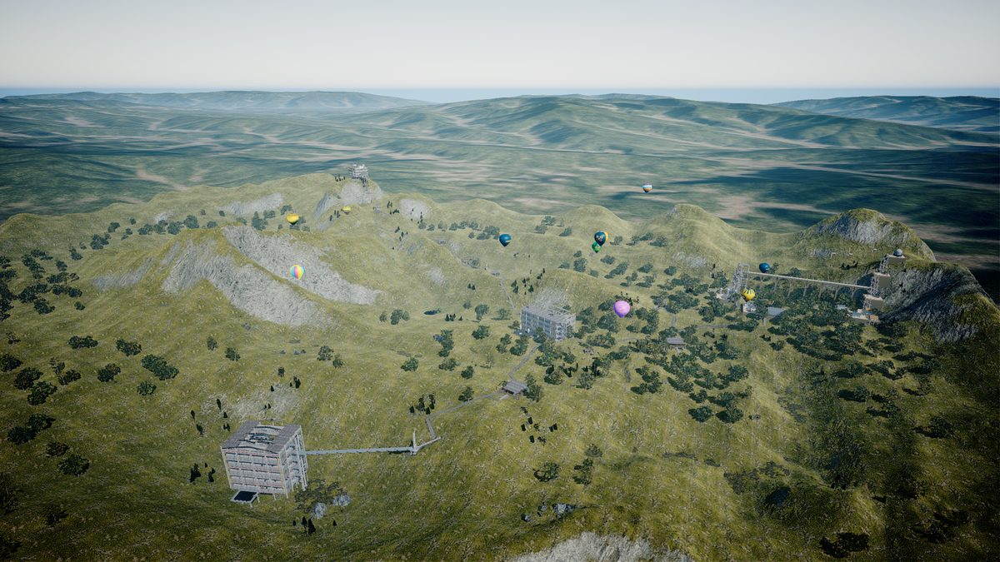
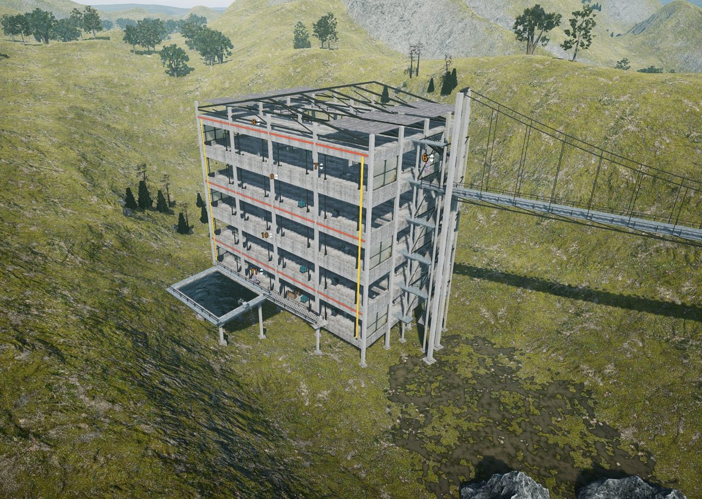

# uncrashed-mcp

MCP for agents to help you create maps for **Uncrashed: FPV Drone Simulator** [buy here](https://store.steampowered.com/app/1682970/Uncrashed_FPV_Drone_Simulator/), inside the game's own track editor. no one-shot, gradual refinement and inspection of the agents work. I figured this would work much better than just one-shot a json map.
it EXPLICITLY does not simulate interacting with the UI or grabbing focus of the game, so you can let this run in the background while doing other things. 

This was done with a small DLL-File which gets injected into your game and places things like you would by "hand" by called the internal functions directly, you can keep editing it normally afterwards obviously.



This is an [MCP](https://modelcontextprotocol.io) server. You can hook it into most modern agents/harnesses, open the track editor, and ask for something like *"build a small mountain village with a gate course through the main street"*. The agent places objects, looks at the result through the game's camera, fixes what's off and saves the map. You watch it happen in the editor.

## Examples

Example builts of a creative agent.

| | | |
| --- | --- | --- |
|  |  |  |

## Optimised for

- **Speed.** One `agent_batch` places a whole group (up to thousands of assets) at once
- **Visual awareness.** `capture_view` renders a compressed screenshot from an arbitrary camera pose, all that in the background.
- **COllision checks.** `drop last` puts an object on whatever is under it vertex perfectly.
- **Self checking.** It makes use of the camera to look for inconsitencies.
- **Robust.** Every command runs under a custom fault guard on the game thread, meaning extra protection from crashes.
- **Not version specific.** No hardcoded addresses. Engine globals are found dynamically, only major track editor changes might break it.
- **Catalogue aware** Knows about the assets in the game, the bounds, collision etc.

## Getting it running

You need:

- Linux, with Uncrashed running through Steam/Proton (Update for windows should be easy, just open in issue)
- Python 3.10 or 3.11 for the mcp package.
- `zig` or `mingw-w64`, to build it.

**1. Install**

```bash
git clone https://github.com/<mkuehn94>/uncrashed-mcp.git
cd uncrashed-mcp
python3.11 -m venv .venv
.venv/bin/pip install -e .
```

**2. Build the agent and injector**

```bash
zig cc -target x86_64-windows-gnu -Wno-date-time -O2 -shared -o native/uncrashed_agent.dll native/agent.c
zig cc -target x86_64-windows-gnu -O2 -municode -o native/inject.exe native/inject.c
```

<details>
<summary>with mingw-w64 instead</summary>

```bash
x86_64-w64-mingw32-gcc -O2 -shared -static -o native/uncrashed_agent.dll native/agent.c
x86_64-w64-mingw32-gcc -O2 -municode -static -o native/inject.exe native/inject.c
```
</details>

**3. Add it to your MCP client**

Claude Code:

```bash
claude mcp add uncrashed -- "$PWD/.venv/bin/python" -m uncrashed_mcp
```

Cursor (`.cursor/mcp.json`):

```json
{
  "mcpServers": {
    "uncrashed": {
      "command": "/path/to/uncrashed-mcp/.venv/bin/python",
      "args": ["-m", "uncrashed_mcp"]
    }
  }
}
```

**4. Use it**

Start the game, open the track editor, and ask your agent for something. It injects the dll and will try to accomplish your goal. It also does quick saves, so if it messes stuff up, its easily recoverable.

- Start on a map preset of your choice.
- If you change `native/agent.c`, rebuild it and call `agent_unload`. The next call injects the new DLL without restarting the game.

## Tests

```bash
.venv/bin/python -m unittest discover tests
```

---

Not affiliated with the developers of Uncrashed. Use at your own risk, and keep backups of maps you care about.

A note on game data: `src/uncrashed_mcp/data/meshes.bin` (simplified collision shapes) and `assets.json` (the editor's asset list with sizes) are taken from the installed game, so the server knows how big things are and about collision details. They are only there to make placement easier. If the developers of Uncrashed would rather not have this data in a public repo, just open an issue or get in touch and I'll take it down immediately.

## Notes

AI was used partially for a lot of the reverse engineering stuff, and general coding assistance, since I made this for myself.
